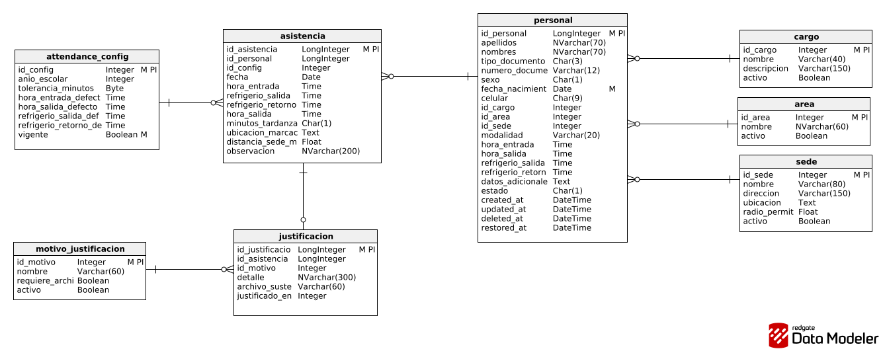
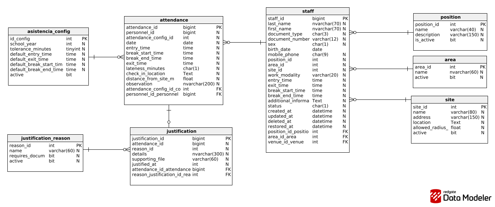

# Caso: Sistema de Control de Asistencia de Personal

## Contexto

Una institución educativa necesita controlar la asistencia diaria de su personal docente y administrativo. Hoy el control es manual y no permite saber con precisión quién llegó tarde, quién faltó, si esa falta está justificada ni desde dónde se marcó la asistencia.

## Requerimientos

1. Registrar al personal con sus datos personales, cargo, área, sede, modalidad de trabajo (presencial, remoto o híbrido) y horario asignado.
2. Mantener catálogos de **cargos**, **áreas** y **sedes**. Cada sede tiene una ubicación geográfica y un **radio permitido** para marcar.
3. Definir por **año escolar** una configuración con el horario por defecto y los **minutos de tolerancia**. Solo una configuración puede estar vigente por año.
4. Registrar la **asistencia diaria** (entrada, salida y retorno del refrigerio, y salida final), como máximo un registro por trabajador y día.
5. Calcular automáticamente los **minutos de tardanza** y la **distancia** entre el punto de marcación y la sede.
6. Rechazar marcaciones de personal presencial hechas fuera del radio de su sede.
7. Registrar **justificaciones** de faltas y tardanzas según un catálogo de **motivos**. Algunos motivos exigen archivo de sustento.
8. Conservar el historial: el personal no se borra físicamente (eliminación lógica, con posibilidad de restaurarlo).
9. Garantizar la recuperación de la información mediante **backups** y **restauración**.

## Entidades

| Modelo lógico | Modelo físico | Descripción |
|---|---|---|
| personal | `staff` | Trabajadores de la institución. |
| asistencia | `attendance` | Registro diario de asistencia. |
| asistencia_config | `attendance_config` | Horarios por defecto y tolerancia por año escolar. |
| justificacion | `justification` | Justificación de una incidencia. |
| motivo_justificacion | `justification_reason` | Catálogo de motivos. |
| cargo | `position` | Catálogo de cargos. |
| area | `area` | Catálogo de áreas. |
| sede | `site` | Catálogo de sedes con ubicación. |

## Relaciones

| Relación | Cardinalidad | Regla |
|---|---|---|
| cargo – personal | 1 : 0..* | Cada trabajador tiene un cargo. |
| área – personal | 1 : 0..* | Cada trabajador pertenece a un área. |
| sede – personal | 1 : 0..* | Cada trabajador está asignado a una sede. |
| personal – asistencia | 1 : 0..* | Un registro por trabajador y día. |
| asistencia_config – asistencia | 1 : 0..* | Cada asistencia usa una configuración. |
| asistencia – justificación | 1 : 0..* | Una asistencia puede tener varias justificaciones. |
| motivo – justificación | 1 : 0..* | Cada justificación tiene un motivo. |

## Diagramas

| Modelo lógico | Modelo físico |
|---|---|
|  |  |

Documentación completa en PDF: [lógico](../resources/Sistema_Control_Asistencia_LOGICO.pdf) · [físico](../resources/Sistema_Control_Asistencia_FISICO.pdf).

## Decisiones de diseño físico

- **Motor:** Microsoft SQL Server.
- **Claves primarias:** generadas con **secuencias** (`*_seq`) mediante `DEFAULT NEXT VALUE FOR`.
- **Ubicación:** el tipo `geography` (SRID 4326) permite calcular distancias reales en metros con `STDistance`.
- **Horas:** `time(0)`, sin fracciones de segundo.
- **Reglas de negocio:** las reglas simples se resuelven con restricciones `CHECK` y `UNIQUE`. Las que dependen de otras tablas (tardanza, radio, sustento, eliminación lógica) se resuelven con **triggers**.
